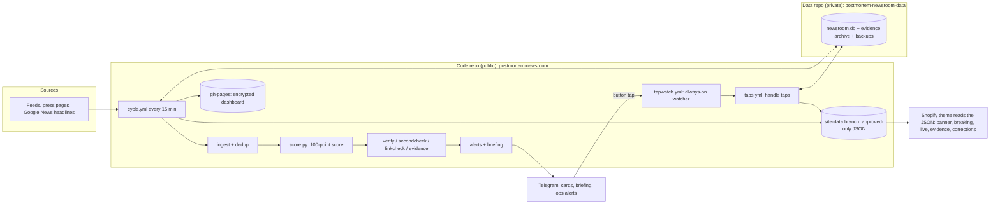

# The Post-Mortem newsroom: architecture

Written from the code and workflows in this repository. Secret **names** only; no values appear anywhere in this file.

## 1. What it is, in one paragraph
A free, cloud-run news desk. GitHub Actions fetch official and outlet feeds, score and de-duplicate the stories, check the facts and sources with deterministic code (no AI scoring), and send you Telegram cards. You approve, reject, mark BREAKING or start LIVE with buttons. Only approved material is exported to a public JSON file that the Shopify theme reads. Nothing is published without your tap.

## 2. Diagram

## 3. Components (all in `newsroom/`)
| File | Job |
|---|---|
| `config/sources.json`, `keywords.json` | Every monitored source (feed, `html_list` press page, or Google News headlines) and the scoring keywords |
| `fetch.py` | Polite HTTP (User-Agent with contact email, retries, never bypasses 401/403), feed parser, press-page reader with robots.txt check, `official-source` tags |
| `ingest.py` | Writes items, groups them into stories (canonical URL, content hash, headline similarity over 48 h) |
| `score.py` | Deterministic 100-point score and category (SEC 8-K classifier, live-blog detection). No AI |
| `verify.py`, `secondcheck.py` | Fact ledger; opens the sources; matches figures and quotes literally; second independent check |
| `evidence.py` | Source records: original URL, publisher, dates, archived copy (archive.org capture or full copy of public records) |
| `linkcheck.py` | Before approval: URL opens, cited text still on the page, archive exists. Weekly re-check of published stories with a Telegram alert |
| `editorial.py` | Drafts, approvals bound to content hashes, breaking flag, live coverage, corrections. Editing voids an approval |
| `review.py`, `cards.py` | The Telegram card, 5-item checklist, buttons, 10-minute Undo; the TEST CARD and the DOJ SAMPLE (both `test_only`, never publishable) |
| `commands.py`, `tapwatch.py` | Reads taps and typed commands; the watcher answers a tap within seconds and starts the worker |
| `notify.py` | Telegram sender with de-duplication (`notifications` table) |
| `briefing.py`, `health.py` | 07:00 Sydney briefing with catch-up; ops alerts (stale radar, dead sources, missed briefing, watcher down) |
| `siteexport.py` | The ONLY bridge to the website: approved-only JSON; skips test cards, leads, unapproved and expired items |
| `dashboard.py` | Encrypted dashboard with the Today view |
| `db.py`, `changelog.py`, `backup.py` | SQLite schema, append-only change log (triggers), backups and restore test |
| `tools.py` | `audit` (fetch every enabled feed once), `selftest`, `acceptance` |

## 4. Data flow, end to end
1. **Sources**: `cycle.yml` fetches every enabled source (bots: radar, primary, trends).
2. **Ingest**: items are normalised, de-duplicated and clustered into stories.
3. **Scoring**: deterministic score; trends are leads only and never alert alone.
4. **Verification**: facts are checked against opened sources; every claim must point at a stored source record.
5. **Telegram**: alert-grade stories become cards with the checklist (sources, facts, dates, second check, links) and buttons. The 07:00 briefing lists the top stories.
6. **Your tap** (Approve / Needs more checking / Reject / Mark BREAKING / Start LIVE / Undo) is acknowledged by `tapwatch` in seconds; `taps.yml` does the work and replies with a "Result" message.
7. **Database**: everything lives in `newsroom.db` in the private data repo, with an append-only change log.
8. **Evidence archive**: source copies and archive.org links, stored with the story ID (`PM-xxxxxx`), the same ID everywhere.
9. **Public feed**: after a tap or cycle, `scripts/publish_site.sh` writes `pm-newsroom.json` to the public `site-data` branch. It contains approved items only.
10. **Website**: the Shopify theme reads that JSON (falls back to a bundled empty file) and draws the banner, Breaking, Live, Evidence Library and Corrections pages. Shopify articles themselves are still published by you.
11. **Dashboard**: an encrypted page on GitHub Pages (`gh-pages`), refreshed with the health run.
12. **Backups**: weekly backup of the data repo plus export/restore tools (`backup.py`).

## 5. Workflows, schedules and safety nets
GitHub's free scheduler often skips runs. Every important job therefore has a second trigger or a watcher.

| Workflow | Schedule | What it does | Safety net |
|---|---|---|---|
| `cycle.yml` | every 15 min | Fetch, ingest, score, alerts, live cards, publish feed | Always-on watcher starts it if more than 20 min overdue; health alerts on a stale radar |
| `health.yml` | :10 and :40 | Health checks, 07:30 briefing catch-up, 08:00 missing-briefing alert, dashboard | Watcher starts it if more than 50 min overdue |
| `briefing.yml` | 07:00 Sydney plus 9 backup slots | The daily briefing | Backup crons, 7:30 catch-up send, 8:00 ops alert |
| `taps.yml` | every 5 min, plus on demand | Processes taps, publishes the approved feed | Started instantly by `tapwatch` on every tap; cycle also handles taps |
| `tapwatch.yml` | every 20 min | About 50-minute watcher: answers taps in seconds, heartbeat for cycle/health | Queued so one always follows another; renews itself at the end; `cycle`, `health` and `taps` restart it and send "Button watcher was down" if it has been idle over 10 min |
| `linkwatch.yml` | Monday 08:30 Sydney plus backup slot | Weekly link and page re-check of published stories | Backup slot; weekly summary is de-duplicated |
| `keepalive.yml` | weekly | Pushes a tiny commit so GitHub does not disable schedules after 60 quiet days | n/a |
| `ops.yml` | manual | audit, selftest, acceptance, briefing-force, testcard, samplecard, linkwatch | n/a |
| `tests.yml` | on push | Full test suite | Blocks nothing automatically; read the result |
| `weekly-backup` (data repo, from `scripts/data-repo-backup.yml`) | Monday 05:30 Sydney | Weekly backup of the database | Restore test in `python -m newsroom restore-test` |

All data-touching workflows share the concurrency group `newsroom-data` so two runs never write the database at once.

## 6. Where each secret lives (names only)
| Name | Kind | Where it is stored | Used by |
|---|---|---|---|
| `TELEGRAM_BOT_TOKEN` | secret | Code repo, Actions secrets | cycle, health, briefing, taps, tapwatch, ops, linkwatch |
| `TELEGRAM_CHAT_ID` | secret | Code repo, Actions secrets | same |
| `DATA_DEPLOY_KEY` | secret | Code repo, Actions secrets (private half); public half is a deploy key on the data repo | `data_pull.sh` / `data_push.sh` |
| `DASHBOARD_PASSWORD` | secret | Code repo, Actions secrets | encrypts the dashboard |
| `YOUTUBE_API_KEY` | secret (optional) | Code repo, Actions secrets | trends |
| `GITHUB_TOKEN` | automatic | Created per run by GitHub | publishes `site-data` / `gh-pages`; watcher starts workflows |
| `DATA_REPO`, `CONTACT_EMAIL` | variables (not secret) | Code repo, Actions variables | data clone; User-Agent contact |
| `.env.local` | local file | Your computer only, in the website folder | Shopify CLI work; never committed |
| Shopify CLI login | session | Your computer | theme pushes |
| Planned: `SHOPIFY_ADMIN_TOKEN` | secret | Will go in Code repo, Actions secrets | Draft-article automation. Not created or used yet |

## 7. What runs where
| Place | What lives there |
|---|---|
| Code repo `xdropau/postmortem-newsroom` (public) | Python code, config, workflows, tests; branches `site-data` (approved-only public JSON) and `gh-pages` (encrypted dashboard) |
| Data repo `xdropau/postmortem-newsroom-data` (private) | `newsroom.db`, evidence archive, audit output, weekly backups |
| GitHub Pages | Encrypted dashboard |
| Shopify (`skecib-y7.myshopify.com`) | The website theme and your articles/pages; reads the public JSON in the visitor's browser |
| Telegram | Your cards, buttons, briefing and ops alerts |
| Your computer | Website theme source, backups of the live theme, Shopify CLI |

## 8. Recovering from failure
| Problem | What to do |
|---|---|
| No 07:00 briefing | You get an 8:00 alert. Run Actions > ops > `briefing-force`. Check Actions > briefing for the reason |
| Taps get no reply | Check Actions > tapwatch has a running job. If not, Actions > tapwatch > Run workflow. You will also get a "Button watcher was down" alert |
| A source shows an error | Actions > ops > `audit`. Fix the URL in `config/sources.json` or disable it with a recorded reason. Never bypass a block |
| A link-problem alert | Open the story, check the source, correct the story if needed. For sites that block robots, open the link yourself and send `/linkok ID CLAIM_ID note` |
| Database damaged | The data repo keeps weekly backups; `python -m newsroom restore-test` verifies a backup, `restore` restores it |
| Bad website change | Online Store > Themes > the previous theme > Publish (one click). Saved copies of the live theme are in `postmortem-site/backups/` |
| Wrong item on the public feed | Reject or Undo in Telegram; the next tap or cycle re-exports. The exporter refuses anything not approved |
| Telegram token leaked | Create a new token in BotFather, update the `TELEGRAM_BOT_TOKEN` secret, redeploy nothing else |
| Schedules stopped for a long time | GitHub disables idle schedules after 60 days; `keepalive.yml` prevents this. Re-enable under Actions if needed |
